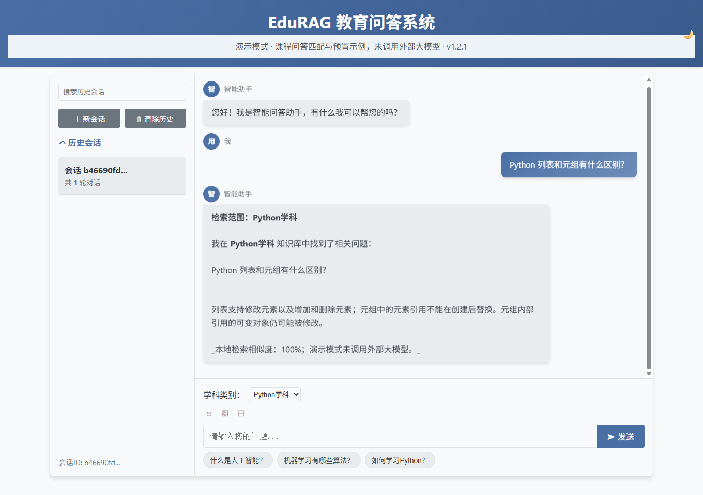
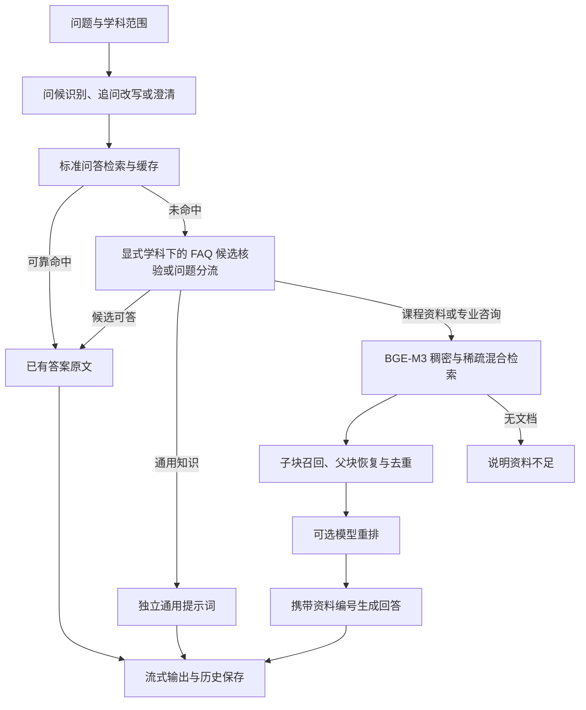

# EduRAG 教育知识库问答系统

基于课程代码改造的 Python 问答原型：优先复用标准问答，未命中时分流到通用讲解或文档 RAG，支持学科范围、多轮追问、真实流式回答和资料来源展示。

**当前源码版本：1.2.1。定位：个人学习与改造项目、本地可验证原型。**

| 模式 | 能力 | 所需环境 |
|---|---|---|
| `demo` | FAQ 字面匹配、预置概念、SQLite 会话、WebSocket 分段展示 | Python 3.12 与轻量依赖 |
| `full` | BM25/Redis、候选模型核验、BGE-M3/Milvus、可选重排、Qwen 真实生成 | Docker、模型权重、完整依赖及有效 API 配置 |
| `auto` | 尝试完整模式，失败后明确显示演示模式 | 按实际 `/health` 状态判断 |

## 快速体验：无需 API Key、Docker 或模型下载

```powershell
python -m venv venv
.\venv\Scripts\python.exe -m pip install -r requirements-demo.txt
$env:EDURAG_MODE = "demo"
.\venv\Scripts\python.exe app.py
```

浏览器访问 `http://127.0.0.1:8088`，接口文档 `/docs`。已有环境也可执行 `./run_demo.ps1 -NoBrowser` 后手动打开终端显示的地址。

Linux/macOS：

```bash
python3 -m venv venv
./venv/bin/python -m pip install -r requirements-demo.txt
EDURAG_MODE=demo ./venv/bin/python app.py
```

源码发布候选默认使用 [8 条自编 FAQ](examples/faq_sample.csv)。例如选择 `Python学科`，问“Python 列表和元组有什么区别？”。本地有 `mysql_qa/data/*.csv` 时优先使用本地资料；也可通过 `EDURAG_FAQ_CSV=examples/faq_sample.csv` 显式选择示例。

演示模式的分段显示是软件演示，不代表调用了大模型。

下面是使用自编 FAQ 的实际浏览器验收截图，页面显示演示模式及版本：



## 完整模式

详细步骤见 [运行说明](RUNNING.md)。完整依赖清单是现有模型环境记录，尚未在全新环境完成完整模式重装验收；轻量环境与离线检查单独验证。

1. 复制 `config.example.ini` 为 `config.ini`，填写 MySQL、Redis 和模型接口配置。
2. 准备 Docker 中的 MySQL、Redis、Milvus、etcd、MinIO。
3. 在 `rag_qa/models/` 准备 BGE-M3、BGE Reranker、BERT 基础模型和已训练查询分类器。权重不随源码分发。
4. 使用自己的可公开资料，或先对自编示例建立独立索引：

```powershell
.\venv\Scripts\python.exe scripts/build_index.py --data-dir examples/knowledge --collection edurag_examples_v1
```

将 `config.ini` 的 `milvus.collection_name` 设为 `edurag_examples_v1`，再运行：

```powershell
.\run_full.ps1 -Port 8090 -NoBrowser -SkipIndex
```

`/health` 应返回版本 `1.2.1`、`mode: full`，`/ready` 返回 200。首页可访问不等于完整 RAG 可用。实际端口以终端输出为准，不要结束占用其他端口的程序。

## 问答流程



具体学科、明确资料请求和课程价格/退款等事实优先进入资料路径。其他问题使用 BERT 分类。分类可能出错，有限规则不等于完备的业务识别。

标准问答使用 BM25；文档稀疏表示来自 BGE-M3。资料名称和片段编号提供核查线索，不自动证明每句话正确。CPU 演示默认关闭模型重排，是否启用需要结合效果与延迟比较。

## 检查与评测

```powershell
.\venv\Scripts\python.exe -m pip install -r requirements-dev.txt
.\venv\Scripts\python.exe scripts/verify.py
.\venv\Scripts\python.exe -m ruff check .
.\venv\Scripts\python.exe scripts/check_demo.py
```

离线检查不需要 Docker、权重或 API Key。`.github/workflows/quality.yml` 配置 Windows/Linux 检查，云端是否通过以仓库实际 Actions 结果为准。

完整服务的真实调用验收：

```powershell
.\venv\Scripts\python.exe scripts/check_routing.py --base-url http://127.0.0.1:8090
```

真实调用会使用配置的模型接口。最新范围与限制见 [验证记录](docs/验证记录.md)。

本地历史运行接入过 467 条课程问答、2 份文档和 99 个子块，并有 62 场景采集与 FAQ 子链路评分。这些数据和分数不属于自编示例的效果，原始题答、资料和评分摘录不放入源码发布候选。两项依赖原始历史题组的测试在缺少这些资料时显式跳过，其他离线检查继续执行。

## 来源、贡献与边界

- 项目基于课程代码；主要改造包括 FAQ 候选核验、追问约束、检索融合、接口与历史修复、评测及发布工具，见 [项目架构](docs/项目架构.md)。
- 上游课程代码的作者、仓库和许可仍待补充，见 [来源说明](THIRD_PARTY_NOTICES.md)。移除课程资料不等于已经确认衍生源码的公开许可。
- 没有登录与会话归属鉴权、连接池或生产并发验收，默认只监听本机。
- 不提交 `config.ini`、API Key、模型权重、数据库卷、日志或个人会话。
- 本地改动、自动评分和少量功能验收均不能当作企业上线或人工回答正确率。

## 准备本地发布候选

```powershell
.\venv\Scripts\python.exe scripts/prepare_release.py
```

脚本按白名单写入新的 `.runtime/releases/edurag-*` 目录并生成文件哈希清单，不覆盖本地数据，不执行网络发布。确认来源与许可后，再将该候选目录用于 GitHub 发布。具体变更见 [发布说明](docs/发布说明.md)。
