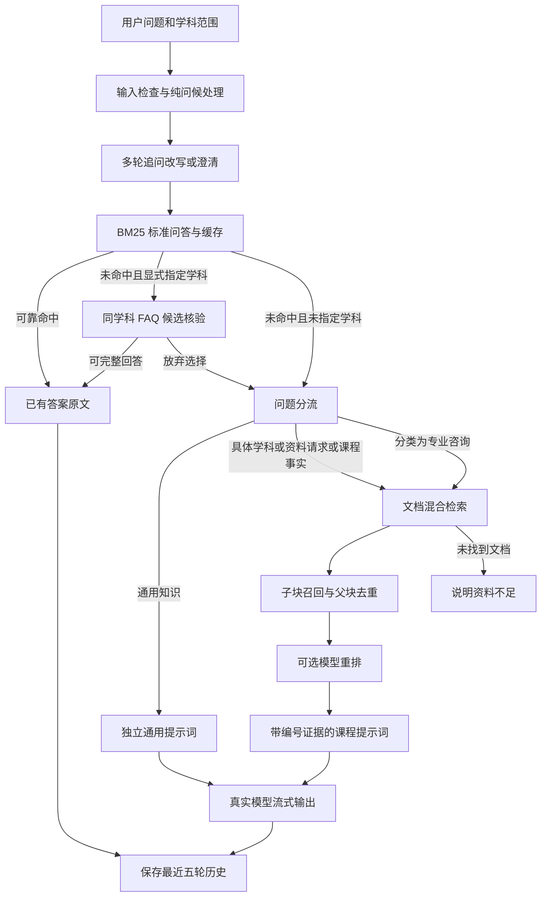

# 项目架构与个人改造

EduRAG 是基于课程代码的学习与改造项目，当前用于本地演示。来源待补充的部分见 [来源说明](../THIRD_PARTY_NOTICES.md)。

## 核心代码

| 文件 | 职责 |
|---|---|
| `app.py` | REST、WebSocket、输入检查、工作线程及单连接锁 |
| `new_main.py` | FAQ、模型候选核验、后续问答与 MySQL 历史 |
| `rag_qa/core/new_rag_system.py` | 分流、原问与增强查询融合、回答及资料列表 |
| `rag_qa/core/query_rewriter.py` | 追问指代、学科变化及实体约束 |
| `rag_qa/core/vector_store.py` | BGE-M3 稠密/稀疏表示、Milvus 融合与可选重排 |
| `rag_qa/core/prompts.py` | 分离通用讲解与课程证据提示词 |
| `demo_backend.py` | 字面匹配和预置说明，不调用模型 |

## 已核对的个人改造范围

重点包括 FAQ 候选核验、版本/符号/否定约束、原问题召回保留与融合、追问处理、接口与历史一致性、流式异常处理、评测与发布工具。面试中应只陈述本人理解并能复现的部分。

## 边界

文档稀疏表示来自 BGE-M3，标准问答的 BM25 是另一条链路。资料列表方便核查，不等于逐句事实校验。当前没有登录与会话归属鉴权、连接池或高并发验收。HyDE、子查询与重排需要按效果和延迟选择，不能因组件更多就认定回答更好。
